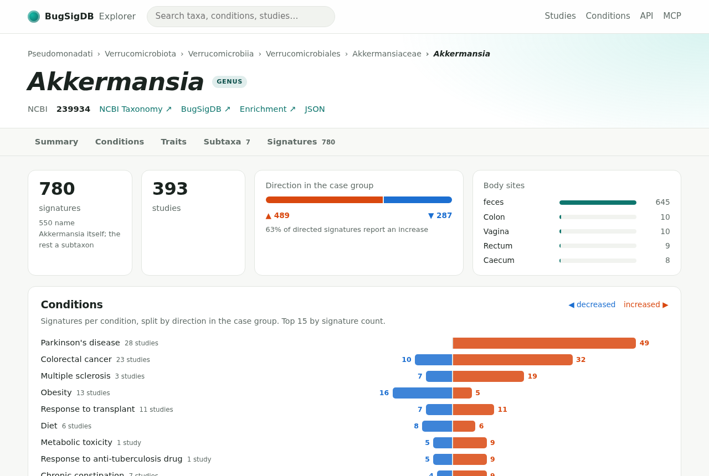

# BugSigDB Explorer

**What does the published microbiome literature say about a microbe, a condition, or a study?**

BugSigDB Explorer organizes the curated signatures in [BugSigDB](https://bugsigdb.org), lists of
taxa reported increased or decreased between groups in published studies, around the things people
actually look up: taxa, conditions and studies. It adds physiology traits from
[bugphyzz](https://github.com/waldronlab/bugphyzz), and serves everything as web pages, a REST API
and an [MCP](https://modelcontextprotocol.io) server for AI agents.

**Try it:** <https://bugsigdb-poc.cancerdatasci.org> (a proof of concept: expect changes)



## What you can do

- **Taxon cards** (in the spirit of [GeneCards](https://www.genecards.org)): every signature that
  names a taxon or any of its descendants, which conditions and body sites they come from, how often
  the taxon goes up versus down, its bugphyzz traits, and its subtaxa.
  Example: [*Akkermansia*](https://bugsigdb-poc.cancerdatasci.org/taxon/239934).
- **Conditions** (EFO/MONDO terms): the studies behind a condition and the taxa reported in its
  signatures, with the up/down split for each.
  Example: [colorectal cancer](https://bugsigdb-poc.cancerdatasci.org/condition/MONDO:0005575).
- **Studies, experiments and signatures**, linked to each other, to PubMed, and back to BugSigDB.
  Signature pages list the most similar signatures by shared taxa.
- **One search box** for taxa, conditions and studies, tolerant of typos, that also takes exact IDs:
  NCBI tax ID, PMID, DOI (or its prefix), EFO/MONDO ID, or `bsdb:study/experiment/signature`.

## Use it from code or an AI agent

REST (read-only JSON; interactive docs at
[`/api/docs`](https://bugsigdb-poc.cancerdatasci.org/api/docs)):

```sh
curl 'https://bugsigdb-poc.cancerdatasci.org/api/search?q=crohn'
curl 'https://bugsigdb-poc.cancerdatasci.org/api/taxa/239934'
curl 'https://bugsigdb-poc.cancerdatasci.org/api/conditions/MONDO:0005180'
```

MCP (streamable HTTP, no auth), for example in Claude Code:

```sh
claude mcp add --transport http bugsigdb https://bugsigdb-poc.cancerdatasci.org/mcp
```

Tools: `search`, `search_taxa`, `get_taxon`, `search_studies`, `get_study`, `get_experiment`,
`get_signature`, `search_conditions`, `get_condition`.

## Data, and how to read it

| Source | What | License |
|---|---|---|
| [BugSigDB](https://bugsigdb.org) ([exports](https://github.com/waldronlab/BugSigDBExports)) | studies, experiments, signatures, taxa, conditions | [CC BY 4.0](https://creativecommons.org/licenses/by/4.0/) |
| [bugphyzz](https://github.com/waldronlab/bugphyzz) ([exports](https://github.com/waldronlab/bugphyzzExports)) | physiology traits, including ones predicted by ancestral state reconstruction | [CC BY-SA 4.0](https://creativecommons.org/licenses/by-sa/4.0/) |
| [NCBI Taxonomy](https://www.ncbi.nlm.nih.gov/taxonomy) | names and lineage, as recorded in BugSigDB | public domain |

Data served by this app carry those licenses; please attribute BugSigDB and bugphyzz when you reuse it.
The database is rebuilt from the public exports, so it can lag BugSigDB by a few days.

Some things to keep in mind:

- A signature is what one study reported for one comparison. Counts of signatures are not
  independent evidence: one study can contribute several.
- BugSigDB records reported changes. Studies that looked for a taxon and found no difference
  are mostly absent, so "increased in 40, decreased in 5" is not a meta-analysis.
- Taxon cards roll up descendants (a genus card includes its species' signatures). Condition pages
  count taxa as curated, without roll-up.
- Only taxa named in at least one signature, and their ancestors, have pages. Names follow current
  NCBI taxonomy (*Segatella copri*, not *Prevotella copri*).

Found a data error? Correct it on [BugSigDB](https://bugsigdb.org) (or report trait errors to
[bugphyzz](https://github.com/waldronlab/bugphyzz/issues)); the fix appears here after the next load.

## How it works

```
BugSigDB + bugphyzz exports ──load.py──▶ Postgres (built in a staging schema, swapped in atomically)
                                              │
                               queries.py (every read query)
                              ╱               │               ╲
                    HTML pages            REST /api            MCP /mcp
                 (web.py, Jinja2)        (FastAPI app.py)     (MCP Python SDK)
```

One FastAPI app, server-rendered HTML with one stylesheet and a small script (no frontend build),
and `pg_trgm` for search. It is read-only by design: BugSigDB is the source of truth.

## Run it locally

Needs Docker, [uv](https://docs.astral.sh/uv/) and [just](https://just.systems).

```sh
git clone https://github.com/seandavi/bugsigdb-app && cd bugsigdb-app
just up      # Postgres + app in Docker; app on http://127.0.0.1:8042
just load    # fetch the public exports and load them (~5 s)
just test
```

The public deployment runs from [`deploy/onclappc02/`](deploy/onclappc02/) (Docker Compose behind
Traefik and Cloudflare); `just release` there rebuilds, reloads the data and restarts.

## Contributing

Bug reports, ideas and pull requests are welcome: start with an
[issue](https://github.com/seandavi/bugsigdb-app/issues). See [CONTRIBUTING.md](CONTRIBUTING.md)
for setup and how the code is organized. Everyone taking part agrees to the
[Code of Conduct](CODE_OF_CONDUCT.md).

## Credits and citation

The data are the work of the BugSigDB and bugphyzz curators and maintainers in the
[Waldron lab](https://github.com/waldronlab) and their community. If you use results from this app,
please cite [BugSigDB](https://bugsigdb.org) and [bugphyzz](https://github.com/waldronlab/bugphyzz)
as their sites describe.

## License

Code: [MIT](LICENSE). Data: see [Data](#data-and-how-to-read-it) above.
